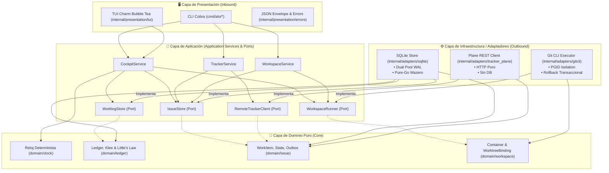

# 🏛️ Arquitectura del Sistema Allostasis (`alo`)

> **Estado:** Canónico / Implementado  
> **Versión:** 0.1.0  
> **Patrón:** Clean Architecture / Hexagonal (Ports & Adapters) / Domain-Driven Design (DDD)

---

## 1. Visión y Fundamentos Ontológicos

En los sistemas vivos, la **homeostasis** persigue mantener un estado interno estático mediante resistencia al entorno. La **alostasis**, en contraste, define la **estabilidad a través del cambio continuo y la adaptación predictiva** (*stability through change*).

En la ingeniería de software moderna:
- Las demandas imprevistas, el soporte de producción urgente, las reuniones y la coordinación informal constituyen la **Carga Alostática** (*Allostatic Load*) del desarrollador.
- Cuando esta carga no se mide, se vuelve **trabajo invisible**: el desarrollador aparenta baja productividad en tickets formales mientras absorbe desgaste cognitivo, derivando en congestión de flujo y *burnout*.
- **Allostasis (`alo`)** es una cabina de control (*developer cockpit*) soberana, **Local-First**, diseñada para regular esta carga sin fricción y sin vigilancia corporativa (*anti-bossware*).

### Principios Rectores:
1. **Soberanía y Local-First:** Tus datos residen primero en tu máquina sobre SQLite WAL. Puedes operar completamente desconectado sin depender de la disponibilidad de servidores remotos.
2. **Cero Fricción en Telemetría:** Registrar una sesión de soporte o deep work toma un único comando (`alo log <TICKET> <MINUTOS>`).
3. **Regulación por la Ley de Little:** $L = \lambda \cdot W$ (WIP = Throughput × Tiempo de Ciclo). Al restringir activamente las tareas simultáneas en vuelo, el tiempo de ciclo disminuye de forma determinista.
4. **Medida de Esfuerzo sin Solapamientos (Unión de Intervalos de Klee):** Si se registran tareas concurrentes o soporte en paralelo, el tiempo neto real se calcula mediante el algoritmo de Klee en $O(N \log N)$, evitando duplicación artificial de horas.
5. **Aislamiento Físico de Contexto:** Los cambios de contexto entre tareas se mitigan mediante Git worktrees transaccionales multi-repo (`alo ws create`).

---

## 2. Topología Hexagonal y Separación de Capas

El sistema implementa estrictamente la **Regla de Dependencia de Clean Architecture**: *las dependencias del código fuente solo pueden apuntar hacia adentro, hacia las políticas de más alto nivel*.



### 2.1 Capa de Dominio (`internal/domain/`)
- **Regla:** **Cero dependencias externas.** Solo interactúa con la biblioteca estándar de Go (`time`, `math`, `sync`, `sort`).
- **Componentes:**
  - `clock`: Abstracción `Clock` con implementaciones `RealClock` para producción y `FrozenClock` determinista para pruebas reproducibles.
  - `ledger`: Modelos de intervalos temporales, cálculo continuo de Klee (`KleeMeasure`), ratios de trabajo profundo vs soporte (`AllostaticLoad`), y proyecciones de tiempo de ciclo con Little's Law.
  - `issue`: Entidades canónicas `WorkItem`, `State`, `Label`, `Link`, `Attachment`, `FocusRecord` y `OutboxRecord`.
  - `workspace`: Entidades `Container`, `WorktreeBinding`, categorías de salud de worktrees y resultados de poda.

### 2.2 Capa de Aplicación y Puertos Canónicos (`internal/app/`)
- **Puertos ([`ports.go`](file:///home/johantv/Code/allostasis/internal/app/ports.go)):**
  - `IssueStore`: Contrato para almacenamiento y consulta de tareas, proyectos, estados y cola outbox.
  - `WorklogStore`: Contrato para el ledger soberano de tiempo e intervalos.
  - `WorkspaceRunner`: Contrato para interacción con el subsistema Git del host.
  - `RemoteTrackerClient`: Contrato para comunicación HTTP con el backend de tracking remoto.
- **Servicios de Aplicación:**
  - `CockpitService`: Agrega métricas holísticas, evalúa sobrecarga alostática y registra tiempo neto.
  - `TrackerService`: Orquesta la persistencia local-first, búsquedas tolerantes FTS y sincronización diferida outbox.
  - `WorkspaceService`: Gestiona el ciclo de vida de contenedores multi-repo, orquestando resolución de repositorios, montado atómico, auditoría de merge status y poda con respaldo `.tar.gz`.

### 2.3 Capa de Adaptadores Outbound (`internal/adapters/`)
- **Aislamiento Total (*Zero Adapter-to-Adapter Leaks*):**
  - Los adaptadores son mutuamente agnósticos. `tracker_plane` no tiene ninguna dependencia hacia SQLite o bases de datos; opera como cliente REST HTTP puro. `gitcli` no abre conexiones a base de datos; recibe un callback `StatusProvider` inyectado por la capa de aplicación.
- **`sqlite.Store`:**
  - Motor SQLite pure-Go sobre WebAssembly (Wazero), compilable con `CGO_ENABLED=0`.
  - **Doble Pool de Conexiones:**
    - `writer`: `SetMaxOpenConns(1)` en modo WAL, serializando escrituras para prevenir `SQLITE_BUSY`.
    - `reader`: `SetMaxOpenConns(runtime.NumCPU() * 2)` con `_pragma=query_only(ON)` para lecturas de ultra-alta concurrencia.
- **`gitcli.GitExecutor`:**
  - Ejecución segura de subprocesos con timeout por contexto.
  - Aislamiento POSIX (`Setpgid`) para matar grupos de procesos huérfanos ante cancelación.
  - Rollback transaccional: si falla el segundo o tercer repositorio en un contenedor multi-repo, revierte automáticamente los worktrees ya creados.

### 2.4 Capa de Presentación e Interfaz (`cmd/alo/`, `internal/presentation/`)
- **Modularidad del CLI Cobra:**
  - [`cmd/alo/main.go`](file:///home/johantv/Code/allostasis/cmd/alo/main.go): Entrypoint ligero (33 líneas) con `signal.NotifyContext` (captura de `SIGINT`/`SIGTERM`) y blindaje de panics.
  - [`cmd/alo/root.go`](file:///home/johantv/Code/allostasis/cmd/alo/root.go): Composición raíz, banderas globales (`--json`, `--db`) y factorías de inyección manual.
  - Comandos temáticos segregados: `cmd_workspace.go`, `cmd_cockpit.go`, `cmd_sync.go`, `cmd_ticket.go`.
- **TUI Reactiva Asíncrona (Charm Bubble Tea):**
  - El refresco en caliente (`'r'`) despacha un `tea.Cmd` asíncrono, garantizando que el bucle de eventos y renderizado de la terminal nunca se congele ante lentitud de I/O.

---

## 3. Principios SOLID Demostrados en el Código

| Principio | Manifestación en la Arquitectura | Archivo de Referencia |
| :--- | :--- | :--- |
| **S (Single Responsibility)** | Cada capa, servicio y comando tiene una única razón de cambio. Los modelos no conocen la persistencia, los adaptadores no conocen el CLI, y los comandos solo parsean y presentan. | [`internal/app/workspace.go`](file:///home/johantv/Code/allostasis/internal/app/workspace.go), [`cmd/alo/cmd_workspace.go`](file:///home/johantv/Code/allostasis/cmd/alo/cmd_workspace.go) |
| **O (Open/Closed)** | Es posible agregar nuevos proveedores de tracking remoto (Linear, GitHub Issues, Jira) implementando la interfaz `RemoteTrackerClient` sin tocar el dominio ni `TrackerService`. | [`internal/app/ports.go`](file:///home/johantv/Code/allostasis/internal/app/ports.go) |
| **L (Liskov Substitution)** | `sqlite.Store` puede ser sustituido por `mockStore` en pruebas unitarias, o `GitExecutor` por `mockWorkspaceRunner`, manteniendo idéntico comportamiento verificable. | [`internal/app/tracker_test.go`](file:///home/johantv/Code/allostasis/internal/app/tracker_test.go), [`internal/app/workspace_test.go`](file:///home/johantv/Code/allostasis/internal/app/workspace_test.go) |
| **I (Interface Segregation)** | Se evitan interfaces monolíticas. `IssueStore`, `WorklogStore`, `WorkspaceRunner` y `RemoteTrackerClient` declaran únicamente los métodos requeridos por sus consumidores. | [`internal/app/ports.go`](file:///home/johantv/Code/allostasis/internal/app/ports.go) |
| **D (Dependency Inversion)** | `CockpitService`, `TrackerService` y `WorkspaceService` dependen exclusivamente de interfaces declaradas en la capa de aplicación, invirtiendo la flecha hacia afuera. | [`internal/app/cockpit.go`](file:///home/johantv/Code/allostasis/internal/app/cockpit.go), [`internal/app/tracker.go`](file:///home/johantv/Code/allostasis/internal/app/tracker.go) |

---

## 4. Patrones de Resiliencia, Concurrencia y Seguridad

### 4.1 CQS (Command-Query Separation) y Local-First Outbox
- **Lecturas Offline-First:** Toda consulta (`alo ticket list`, `alo agenda`, `alo load`, `alo ticket search`) se resuelve exclusivamente desde la base local SQLite en $< 5\text{ms}$.
- **Escrituras Resilientes (Outbox Pattern):** Si el servidor de Plane CE no está disponible al crear una tarea o registrar una bitácora, la mutación se persiste localmente y se encola en la tabla `outbox` con estado `pending`.
- **Reconciliación Upstream:** El comando `alo sync` procesa la cola por lotes idempotentes, actualizando `sent_at` y `plane_comment_id` sin duplicar registros.

### 4.2 Blindaje Machine-to-Machine (M2M) para Agentes de IA
- Cuando se especifica `--json`, el CLI inhibe cualquier formateador ANSI y produce payloads con esquema formal:
  ```json
  {
    "ok": true,
    "data": { ... }
  }
  ```
- Ante errores, se emite un sobre estructurado con categorización semántica, sugerencia de comando y código de salida POSIX estándar:
  ```json
  {
    "ok": false,
    "error": {
      "code": "AUTH_FAILED",
      "category": "auth",
      "message": "autenticación rechazada en Plane (HTTP 401)",
      "hint": "Verifica PLANE_API_KEY y PLANE_BASE_URL",
      "recoverable": true
    }
  }
  ```

### 4.3 Seguridad Defensiva en Operaciones Git
- **Anti Flag Injection:** Se validan los nombres de ramas y referencias base, rechazando valores que comiencen con `-` (ej. `--orphan`, `--lock`).
- **Anti Path Traversal:** Se valida que los nombres de repositorio y rutas de contenedores no contengan secuencias `../` que puedan escapar del directorio `.worktrees/`.
- **Poda con Respaldo Automático:** Antes de eliminar físicamente un worktree mergeado o abandonado, `alo ws prune --execute` genera un archivo `.tar.gz` de seguridad en `~/.cache/allostasis/backups/`.

---

## 5. Estrategia de Pruebas y Determinismo

- **Latencia de Pruebas:** La suite completa de pruebas unitarias, de integración y adversariales se ejecuta en **$< 3$ segundos** con detección de carreras (`go test -race ./...`).
- **Determinismo Temporal:** Los cálculos de Little's Law y Klee se prueban con `clock.NewFrozenClock(time)`, garantizando que el paso del tiempo de reloj de pared no altere las aserciones de prueba.
- **Pruebas de Estrés y Límites:**
  - Estrés de 10,000 intervalos en la Medida de Klee.
  - Concurrencia masiva de 400 escrituras paralelas en SQLite bajo WAL mode sin bloqueos `SQLITE_BUSY`.
  - Simulación de fallos a mitad de transacción en worktrees multi-repo con verificación de estado limpio en disco.
