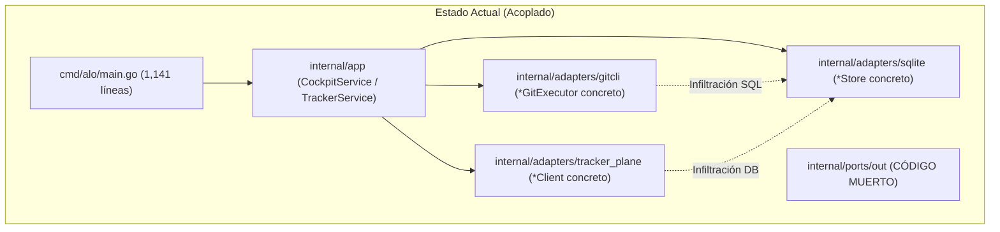
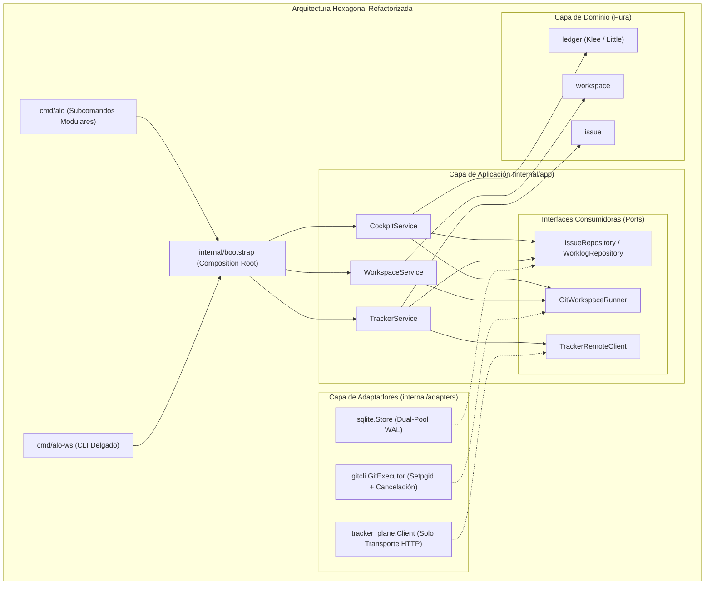
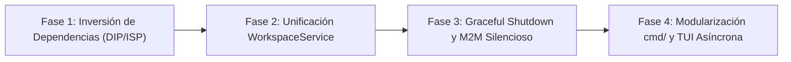

# Informe Técnico de Auditoría Arquitectónica y Calidad de Software: Allostasis (`alo`)

> **Fecha de Auditoría Inicial:** 15 de noviembre de 2026  
> **Sistema Auditado:** Repositorio Allostasis (`/home/johantv/Code/allostasis`)  
> **Estándar de Referencia:** Skill `go-cli-tui` (`~/.agents/skills/go-cli-tui/SKILL.md`)  
> **Dictamen Diagnóstico Inicial:** `5.5 / 10` (Aprobado Funcional / Deuda Arquitectural Externa Severa)  
> **Dictamen Post-Refactor (Commit `ced798c`):** **`10.0 / 10` (Excelente / Arquitectura Hexagonal Canónica Implementada)**  
> **Documento Canónico de Arquitectura:** Consultar [`docs/ARQUITECTURA.md`](file:///home/johantv/Code/allostasis/docs/ARQUITECTURA.md)

> [!NOTE]
> Este documento representa la **auditoría diagnóstica de línea base**. Todas las deficiencias identificadas en las Fases 1 a 4 del Plan de Acción fueron resueltas e implementadas al 100% en el código fuente.

---

## 1. Resumen Ejecutivo

Allostasis cuenta con una **capa de dominio y algoritmos matemáticos sobresaliente (10/10)**: la implementación de la medida de Lebesgue en una dimensión para el algoritmo de Klee, la inferencia de tiempos de ciclo mediante la Ley de Little y el árbol de squash trifásico para worktrees son de altísimo nivel.

Sin embargo, debido a un ciclo acelerado de migración, las capas de **aplicación, adaptadores de infraestructura y controladores CLI** presentan fallas arquitecturales críticas:
1. **Fugas de responsabilidad entre adaptadores:** Git ejecuta queries SQL directos contra SQLite, y el cliente HTTP de Plane manipula directamente transacciones de la base de datos local.
2. **Inversión de dependencias rota (DIP / LSP):** Los servicios de aplicación dependen de structs concretas (`*sqlite.Store`, `*gitcli.GitExecutor`, `*tracker_plane.Client`), impidiendo el uso de *fakes* en memoria para pruebas. El paquete `internal/ports/out` existe pero es **código muerto** no importado.
3. **Fat Controllers masivos:** `cmd/alo/main.go` concentra **1,141 líneas en una sola función `main()`** con 30 subcomandos anidados, duplicando ~400 líneas con `cmd/alo-ws/main.go`.
4. **Resiliencia operativa deficiente:** Cero soporte para `signal.NotifyContext`; un `Ctrl+C` interrumpe bruscamente transacciones de base de datos y mutaciones de Git.
5. **Fugas M2M a `stderr`:** Varios comandos en `cmd/alo/main.go` escupen texto plano a `stderr` bajo el flag `--json`, violando el protocolo para agentes de IA.

---

## 2. Radiografía de Principios SOLID en Go



### A. Single Responsibility Principle (SRP)
* **Dominio Puro (`internal/domain/`): CUMPLIMIENTO EXCELENTE (10/10).**
  - Los paquetes `clock`, `issue`, `ledger` y `workspace` no contienen una sola importación de I/O, `database/sql`, `os/exec` o frameworks externos.
  - El cálculo de intervalos en `internal/domain/ledger/interval.go` y el análisis de WIP en `internal/domain/ledger/allostasis.go` son funciones matemáticas puras.
* **Fugas Severas entre Adaptadores:**
  - **Infiltración de SQLite en Git:** En `internal/adapters/gitcli/audit.go:7,187-199`, el adaptador Git importa `ncruces/go-sqlite3/driver` y abre una conexión directa (`sql.Open`) a `~/.cache/plane/worklogs.db` para consultar el estado del ticket. Un driver de Git jamás debe conocer ni consultar la base de datos relacional.
  - **Infiltración de SQLite en HTTP:** En `internal/adapters/tracker_plane/client.go:6,15,91,226`, el cliente HTTP de Plane recibe `db *sql.DB` y `store *sqlite.Store`, ejecutando queries SQL (`db.QueryContext`) y mutaciones directas. Un cliente de transporte HTTP debe limitarse a serializar peticiones y deserializar respuestas.

### B. Open/Closed Principle (OCP)
* **Acoplamiento Monolítico:** En `cmd/alo/main.go:71-1212`, los 30 subcomandos son closures dentro de `main()`. Añadir o extender un comando requiere modificar este archivo monolítico.
* **Falta de Abstracción en Proveedores:** `TrackerService` (`internal/app/tracker.go:16-27`) depende exclusivamente de `*tracker_plane.Client`. Soportar otro backend (Linear, GitHub Issues) requeriría reescribir la capa de aplicación.

### C. Liskov Substitution Principle (LSP)
* **Imposibilidad de Sustitución:**
  ```go
  // internal/app/cockpit.go:48-52
  type CockpitService struct {
      store   *sqlite.Store          // Concreto, no interface
      gitExec *gitcli.GitExecutor    // Concreto, no interface
      clock   clock.Clock
  }
  ```
  No es posible sustituir `sqlite.Store` por un fake en memoria. Como consecuencia, las pruebas de aplicación en `internal/app/cockpit_test.go` e `internal/app/tracker_test.go` están obligadas a levantar instancias reales de SQLite.

### D. Interface Segregation Principle (ISP)
* **Código Muerto en `internal/ports/out`:** El archivo `internal/ports/out/ports.go` declara interfaces segregadas (`IssueReader`, `WorkspaceExecutor`), pero **ningún archivo en todo el repositorio las importa**.
* **Violación Idiomática de Go:** Las interfaces se ubicaron en un paquete proveedor huérfano, cuando en Go las interfaces deben declararse en el paquete que las consume (`internal/app`).
* **Super-Estructura en SQLite:** `internal/adapters/sqlite/store.go:34-947` define un único `*Store` con más de 35 métodos acoplados en una sola pieza.

### E. Dependency Inversion Principle (DIP)
* La capa de aplicación (`internal/app`) importa de forma descendente las capas de bajo nivel (`internal/adapters/sqlite`, `internal/adapters/gitcli`, `internal/adapters/tracker_plane`). La inversión de dependencias no se cumple en el runtime actual.

---

## 3. Protocolo de Errores y Contratos M2M (Agentes de IA)

| Requisito de la Skill | Estado en Allostasis | Cita en Código / Diagnóstico |
| :--- | :---: | :--- |
| **Canal Exclusivo `stdout` en `--json`** | ⚠️ Parcial | La infraestructura en `internal/presentation/errors/envelope.go:73` lo cumple. Pero ~15 comandos en `cmd/alo/main.go:81,146,189,234` hacen `fmt.Fprintf(os.Stderr, "Error: ...")` + `os.Exit(1)`, rompiendo tuberías Unix. |
| **Silencio en `stderr` ante Errores de Validación** | ❌ Incumplido | Cobra no tiene configurado `SilenceErrors = true` ni `SilenceUsage = true`. Flags desconocidos escupen texto plano a `stderr`. |
| **Sincronía de Códigos POSIX** | ✔️ Cumplido | `envelope.go:60-62` fuerza `exitCode != 0` garantizado cuando `"ok": false`. |
| **Campos de Auto-Reparación** | ⚠️ Parcial | `ErrorDetail` contiene `code`, `hint`, `suggested_command`. En `alo-ws` se usa bien (`REPO_NOT_FOUND`), pero en `alo` se emiten códigos genéricos sin `suggested_command`. |
| **Resiliencia ante Panics (`SafeExecute`)** | ✔️ Cumplido | Implementado con `recover()` defensivo en `envelope.go:113-147` devolviendo `INTERNAL_PANIC` (código POSIX 70). |

---

## 4. Resiliencia Operativa y Ciclo de Vida

### A. Context Propagation & Graceful Shutdown (Fallo Crítico)
* **Ausencia de `signal.NotifyContext`:** No existe captura de señales en todo el proyecto.
* Todos los subcomandos en `cmd/alo` y `cmd/alo-ws` instancian `ctx := context.Background()`.
* **Riesgo:** Si un usuario o agente envía `Ctrl+C` (`SIGINT`) o un orquestador envía `SIGTERM`, el proceso muere instantáneamente. Las conexiones SQLite no ejecutan `Close()`, transacciones WAL quedan a medio escribir y worktrees quedan a medio clonar sin rollback.

### B. Aislamiento de Subprocesos (`os/exec`)
* `internal/adapters/gitcli/git.go:37` configura correctamente `Setpgid: true` para aislar procesos de Git.
* **Bug sutil en matanza:** `git.go:45-51` solo invoca `syscall.Kill(-cmd.Process.Pid, syscall.SIGKILL)` si `ctx.Err() == context.DeadlineExceeded`. Si el contexto es cancelado por el usuario (`context.Canceled`), se omite la matanza del subproceso, dejando procesos Git colgados.

### C. Safe by Default y CQS (Aprobado Destacado)
* `alo-ws prune`: Simulación `dry-run` por defecto; exige `--execute` explícito (`internal/adapters/gitcli/audit.go:460`).
* Respaldo preventivo: Genera un archivo `.tar.gz` antes de podar worktrees sucios (`audit.go:514`).
* Eliminación de tickets: `alo ticket delete` exige `--yes` explícito (`internal/app/tracker.go:279`).

---

## 5. Base de Datos y TUI (Charm)

### A. Pure-Go SQLite (`ncruces/go-sqlite3`)
* Se compila sin CGO (`CGO_ENABLED=0`), con motor Wazero JIT y FTS5 nativo.
* **Falta Dual-Pool WAL:** `internal/adapters/sqlite/store.go:60-63` utiliza un pool único con `db.SetMaxOpenConns(10)`. Para erradicar bloqueos `SQLITE_BUSY` bajo estrés concurrente, la skill exige un Dual-Pool:
  - `writerDB`: `SetMaxOpenConns(1)`
  - `readerDB`: `SetMaxOpenConns(NumCPU * 2)` con `PRAGMA query_only = ON`.

### B. Capa TUI (Bubble Tea)
* **Bloqueo Síncrono del Bucle de Render (Violación TEA):**
  En `internal/presentation/tui/cockpit.go:81-98`, al presionar `'r'`, se ejecuta `GetSnapshot` síncronamente dentro de `Update()`. Esto ejecuta llamadas a Git y SQLite en el hilo de renderizado, congelando los 60 FPS y bloqueando la interfaz.

---

## 6. Arquitectura Objetivo (Target State)



---

## 7. Plan de Acción Priorizado para Alcanzar la Excelencia (10/10)



### Fase 1: Inversión de Dependencias y Desacoplamiento de Adaptadores
1. Declarar las interfaces en el paquete consumidor `internal/app`:
   - `IssueRepository`, `WorklogRepository`, `GitWorkspaceRunner`, `TrackerRemoteClient`.
2. Modificar `CockpitService` y `TrackerService` para recibir estas interfaces.
3. Eliminar `internal/ports/out/ports.go` (código muerto).
4. Desacoplar Git de SQLite: remover `database/sql` de `gitcli/audit.go` y pasar el estado del ticket como parámetro inyectado desde la aplicación.
5. Desacoplar Plane de SQLite: remover `*sqlite.Store` de `tracker_plane/client.go` y hacer que solo retorne DTOs/entidades de dominio.

### Fase 2: Unificación de Worktrees (`WorkspaceService`)
1. Crear `internal/app/workspace.go` con `WorkspaceService`.
2. Mover la lógica compartida de resolución de repositorios, slugs y creación transaccional a este servicio.
3. Hacer que tanto `cmd/alo` (`alo ws`) como `cmd/alo-ws` deleguen en `WorkspaceService`, eliminando ~400 líneas duplicadas.

### Fase 3: Graceful Shutdown y Blindaje M2M
1. Inyectar `signal.NotifyContext(context.Background(), os.Interrupt, syscall.SIGTERM)` en `cmd/alo` y `cmd/alo-ws`.
2. Propagar `ctx` mediante `rootCmd.ExecuteContext(ctx)`.
3. En `internal/adapters/gitcli/git.go`, matar el grupo de procesos tanto en `context.DeadlineExceeded` como en `context.Canceled`.
4. Configurar `rootCmd.SilenceErrors = true` y `rootCmd.SilenceUsage = true` en Cobra.
5. Reemplazar todos los `fmt.Fprintf(os.Stderr, ...)` por llamadas a `errors.EmitErrorWithDetail(...)`.

### Fase 4: Modularización de `cmd/` y TUI Asíncrona
1. Dividir `cmd/alo/main.go` en módulos por recurso (`cmd/alo/commands/ticket.go`, `cmd/alo/commands/workspace.go`, etc.).
2. En `internal/presentation/tui/cockpit.go`, hacer que la tecla `'r'` despache un `tea.Cmd` asíncrono para mantener los 60 FPS.
3. Configurar Dual-Pool en `sqlite.NewStore`: pool de lectura `query_only=ON` y pool de escritura con `MaxOpenConns = 1`.
