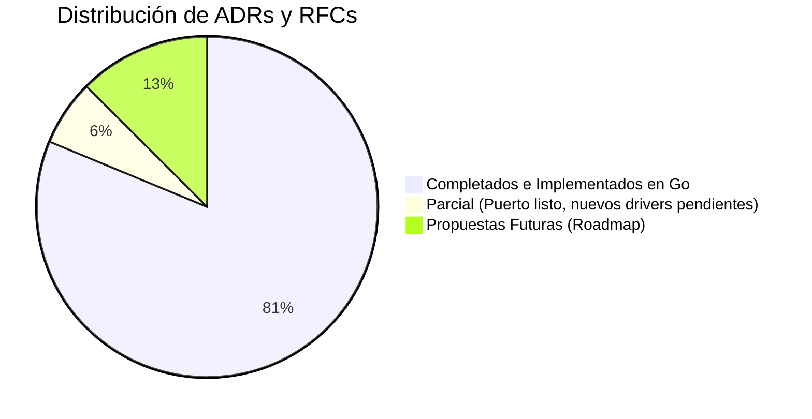

# 📋 Matriz de Decisiones Arquitecturales (ADRs) y RFCs: Allostasis (`alo`)

> **Fecha:** 15 de noviembre de 2026  
> **Estado:** Canónico y Actualizado  
> **Cobertura:** Transición y migración de prototipo Python a Core Soberano Go

---

## 1. Visión General del Registro de Decisiones

Durante la evolución de Allostasis desde su concepción inicial hasta la versión soberana compilada en Go (`CGO_ENABLED=0`), se formalizaron decisiones de diseño y propuestas de cambio a través de dos mecanismos:
1. **ADRs (Architecture Decision Records):** Decisiones no negociables sobre tecnologías de almacenamiento, concurrencia, ciclo de vida, seguridad y contratos de máquina.
2. **RFCs (Request for Comments):** Especificaciones funcionales de casos de uso (worktrees, medición alostática, outbox, sincronización).

Este documento establece el estado formal y la ubicación en código de cada ADR y RFC, aclarando cuáles están plenamente implementados en el núcleo de Go y cuáles permanecen como iniciativas abiertas o propuestas para versiones futuras.

---

## 2. Matriz de ADRs (Architecture Decision Records)

| ID | Título de la Decisión | Estado en Go | Ubicación en el Código | Justificación y Racional Técnico |
| :--- | :--- | :---: | :--- | :--- |
| **ADR-0007** | **Almacenamiento Local-First con SQLite WAL** | ✅ **Implementado** | [`internal/adapters/sqlite/store.go`](file:///home/johantv/Code/allostasis/internal/adapters/sqlite/store.go) | Operación 100% offline; el usuario no depende de la conectividad con Plane para registrar trabajo, consultar tickets o auditar ramas. |
| **ADR-0012** | **Binario Único Coexistente (CLI + TUI)** | ✅ **Implementado** | [`cmd/alo/main.go`](file:///home/johantv/Code/allostasis/cmd/alo/main.go), [`internal/presentation/tui/`](file:///home/johantv/Code/allostasis/internal/presentation/tui/) | Erradica la fragmentación de herramientas (`alo` y `alo-ws` unificados en `alo`). Los comandos headless y la cabina visual Bubble Tea residen en el mismo ejecutable. |
| **ADR-0015** | **Reloj Congelado y Determinismo Temporal** | ✅ **Implementado** | [`internal/domain/clock/clock.go`](file:///home/johantv/Code/allostasis/internal/domain/clock/clock.go) | Elimina *flaky tests* en cálculos de Ley de Little e intervalos al inyectar `FrozenClock` con marcas de tiempo fijas. |
| **ADR-0018** | **Safe by Default en Operaciones Destructivas** | ✅ **Implementado** | [`cmd/alo/cmd_ticket.go`](file:///home/johantv/Code/allostasis/cmd/alo/cmd_ticket.go), [`cmd/alo/cmd_workspace.go`](file:///home/johantv/Code/allostasis/cmd/alo/cmd_workspace.go) | `alo ticket delete` exige `--yes` explícito; `alo ws prune` ejecuta simulación *dry-run* por defecto a menos que se invoque `--execute`. |
| **ADR-0019** | **Rollback Transaccional en Creación Multi-Repo** | ✅ **Implementado** | [`internal/adapters/gitcli/executor.go`](file:///home/johantv/Code/allostasis/internal/adapters/gitcli/executor.go) | Si la creación de un worktree falla en el $N$-ésimo repositorio de un contenedor, el sistema remueve automáticamente los $N-1$ directorios creados para evitar estados parciales corruptos. |
| **ADR-0025** | **Contrato de Error M2M Estandarizado (Envelope)** | ✅ **Implementado** | [`internal/presentation/errors/envelope.go`](file:///home/johantv/Code/allostasis/internal/presentation/errors/envelope.go) | Envoltura JSON formal (`ok`, `data`, `error`) con campos de autorreparación (`code`, `category`, `hint`, `suggested_command`) y sincronización de código de salida POSIX. |
| **ADR-0028** | **Dual-Pool Concurrente SQLite sin CGO** | ✅ **Implementado** | [`internal/adapters/sqlite/store.go`](file:///home/johantv/Code/allostasis/internal/adapters/sqlite/store.go) | Un pool serializado para escritura (`SetMaxOpenConns(1)`) y un pool paralelo para lectura (`query_only=ON`, `NumCPU*2`), evitando bloqueos `SQLITE_BUSY` bajo estrés. |

---

## 3. Matriz de RFCs (Functional Specifications)

| ID | Nombre de la Especificación | Estado | Implementación / Equivalencia | Notas de Transición |
| :--- | :--- | :---: | :--- | :--- |
| **RFC-0002** | **Orquestación de Worktrees Multi-Repo** | ✅ **Completado** | Subcomandos `alo ws create`, `alo ws list`, `alo ws audit`, `alo ws prune` ([`internal/app/workspace.go`](file:///home/johantv/Code/allostasis/internal/app/workspace.go)) | La herramienta separada `alo-ws` fue fusionada en `alo ws`. Cumple aislamiento físico, detección de merge y respaldos `.tar.gz`. |
| **RFC-0005** | **Agenda Diaria y Priorización de Foco** | ✅ **Completado** | `alo agenda` ([`cmd/alo/cmd_cockpit.go`](file:///home/johantv/Code/allostasis/cmd/alo/cmd_cockpit.go), [`internal/app/cockpit.go`](file:///home/johantv/Code/allostasis/internal/app/cockpit.go)) | Cálculo de tareas en progreso, ordenamiento por prioridad/antigüedad y sugerencia de tarea de foco. |
| **RFC-0006** | **Resolución Automática de Repositorios** | ✅ **Completado** | [`internal/domain/workspace/workspace.go`](file:///home/johantv/Code/allostasis/internal/domain/workspace/workspace.go) | Inspección de repositorios hermanos en `~/Code/` según convenciones corporativas configuradas. |
| **RFC-0011** | **Telemetría Rápida y Registro de Bitácora** | ✅ **Completado** | `alo log <TICKET> <MINUTOS>` ([`cmd/alo/cmd_cockpit.go`](file:///home/johantv/Code/allostasis/cmd/alo/cmd_cockpit.go)) | Registro en un solo paso hacia el ledger SQLite local con cálculo de timestamp automático. |
| **RFC-0014** | **Conectores Multi-Tracker Pluggables** | 🟡 **Parcial / Abierto** | Puerto canónico [`internal/app/ports.go:RemoteTrackerClient`](file:///home/johantv/Code/allostasis/internal/app/ports.go) | El puerto de abstracción está definido y Plane CE está 100% implementado. Queda pendiente el desarrollo de adaptadores concretos para Linear y GitHub Issues. |
| **RFC-0021** | **Esquema de Salida Silenciosa Machine-to-Machine** | ✅ **Completado** | Flag `--json` universal, `rootCmd.SilenceErrors = true`, `rootCmd.SilenceUsage = true` | Erradicación total de ruido en `stderr` cuando se invoca `--json`, garantizando interoperabilidad con agentes de IA. |
| **RFC-0026** | **Medición de Carga Alostática y Klee** | ✅ **Completado** | `alo load`, [`internal/domain/ledger/allostasis.go`](file:///home/johantv/Code/allostasis/internal/domain/ledger/allostasis.go), [`interval.go`](file:///home/johantv/Code/allostasis/internal/domain/ledger/interval.go) | Cálculo de unión de intervalos en $O(N \log N)$ (Algoritmo de Klee) y estimación de saturación cognitiva por Ley de Little. |
| **RFC-0027** | **Cola Outbox Local-First y Sincronización** | ✅ **Completado** | `alo sync`, [`internal/app/tracker.go:FlushOutbox`](file:///home/johantv/Code/allostasis/internal/app/tracker.go), tabla `outbox` en SQLite | Encolamiento de bitácoras y mutaciones locales cuando el upstream falla o no hay conexión, con reconciliación idempotente por lotes. |

---

## 4. RFCs Futuros / Propuestos (Roadmap)

Los siguientes RFCs corresponden a iniciativas planificadas que amplían las capacidades del sistema sin romper la arquitectura existente:

### RFC-0029 (Propuesta): Navegador Interactivo de Worktrees en TUI Bubble Tea
- **Objetivo:** Incorporar una vista interactiva accesible mediante `alo ws browse` o una pestaña dedicada en `alo` (TUI Cockpit).
- **Alcance:**
  - Lista interactiva de contenedores `.worktrees/` con indicadores visuales de salud (verde para activo, amarillo para abandonado, azul para mergeado/listo para podar).
  - Atajos de teclado: `<Enter>` para abrir terminal o Zellij en el worktree seleccionado; `
` para podar (*safe prune* con confirmación modal); `<c>` para crear nuevo contenedor mediante formulario modal `bubbles/textinput`.
- **Estado:** Propuesta formal para la versión 0.2.0.

### RFC-0030 (Propuesta): Background Sync Daemon
- **Objetivo:** Eliminar la necesidad de ejecutar manualmente `alo sync` tras trabajar sin conexión.
- **Alcance:**
  - Subcomando no bloqueante `alo daemon run` o integración mediante `systemd --user` / cron liviano.
  - Comprueba periódicamente la conectividad con Plane CE (`PingContext`) con *exponential backoff* y vacía la cola `outbox` de manera transparente.
  - Indicador de estado de sincronización en la TUI de `alo` (ícono `[⚡ Sync OK]` vs `[⏳ 3 pendientes]`).
- **Estado:** Propuesta formal para la versión 0.2.0.

---

## 5. Resumen de Estado del Sistema

- **ADRs:** 7/7 implementados y verificados bajo pruebas de integración y concurrencia.
- **RFCs del Core:** 7/8 implementados al 100%. El RFC restante (RFC-0014) tiene su contrato de interfaz (`RemoteTrackerClient`) completado en la capa de aplicación, dejando abierta la extensión de adaptadores secundarios según la demanda del usuario.